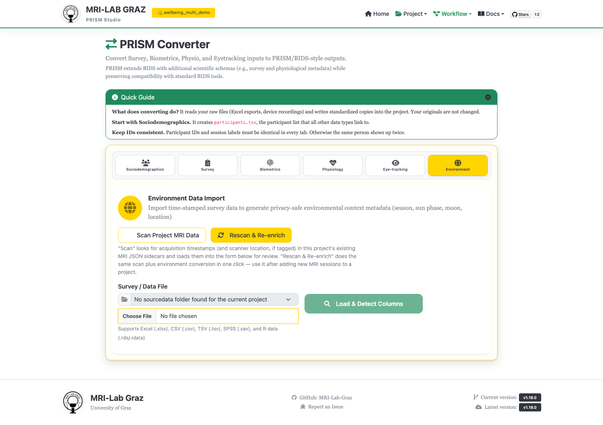

# Converter — Environment

Imports timestamped data (a survey export, a scan log, anything with a timestamp
column) and enriches it into environment metadata (format 2.0.0): weather, air quality, pollen, season,
sun and moon, time of day, heat status and weather regime. Each column points to an official term;
raw addresses are not exported.



## Optional: pull timestamps from MRI data

If your project has MRI JSON sidecars, **Scan Project MRI Data** reads acquisition
timestamps and scanner location straight from them into the form. **Rescan &
Re-enrich** does a scan-and-convert pass in one click.

## Step 1 — Select file

**Survey / Data File** accepts `.xlsx`, `.csv`, `.tsv`, `.sav`, `.rds`, `.rdata`,
`.rda`. A separator selector appears for delimited files. Click **Load & Detect
Columns** to reveal the mapping section below.

## Step 2 — Required mapping

- **Timestamp Column \***
- **Participant ID Column \***
- **Session Column \*** — a dropdown, plus a free-text override for a fixed session
  ID. A session column processes all sessions in one run; a fixed ID applies to every
  row, so you repeat the import once per session for multi-session files.

## Step 3 — Optional location fields

- **Location Label Column** — resolves coordinates only; the label itself is not
  exported.
- **Coordinates Columns** (lat/lon) — per-row override of the global fallback below.
- **Location Picker** — search a place name, pick from results, auto-fills lat/lon.
- **Manual Location Label** / **Latitude** / **Longitude** — global fallback used
  when a row has no per-row location.

A preview table shows the first 5 rows once columns are mapped.

## Step 3b — Time windows (optional)

The **Time windows** list summarises a variable over a period before each session, for example
`temp_c`, `P3D`, `max` for the highest temperature in the three days before. Pick the variable, an ISO 8601 duration
(`PT12H`, `P3D`; years and months are not accepted) and a statistic (mean, min, max, sum, count; a `count` column is a number of hours, so its unit is `1`, not the variable's unit). Windows are half-open
(session - duration, session]. Rows left empty or built from a partial window are listed in the conversion summary.
Each window becomes a column named `<var>_<stat>_<duration lowercased>`, for example `temp_c_max_p3d` or
`temp_c_sum_p1dt12h`.
Each run rewrites the root sidecar with its own window set: re-run all sessions with the same windows (files from
earlier runs with other windows get "undescribed column" warnings).
Command line: `environment convert --window VAR:DURATION:STAT`.

## Step 4 — Convert

Optionally check **Convert in background (nohup-style)** for long-running jobs, then
either **Pilot Run (1 random subject)** to sanity-check the mapping quickly, or
**Convert** for the full run. A progress bar, collapsible Conversion Log, and a
**Converted Output Preview** (first 4 subjects/rows) appear as it runs.

## Output

```text
sub-<label>/ses-<label>/environment/sub-<label>_ses-<label>_recording-weather_environment.tsv
```

Environment files from format 1.1.0 are retired: the validator asks you to re-create them with the converter.

## What's next

- [Converter — Participants](converter_participants.md)
- [Validator](validator.md)

```{note}
In a project whose Study Design says **one timepoint** (cross-sectional), the session controls on this page are
greyed out (**ONE TIMEPOINT**): every import is written as `ses-1`, and a session label other than `1` in the
file is reported in the log. Declare several timepoints on the Projects page to choose or map sessions.
```
