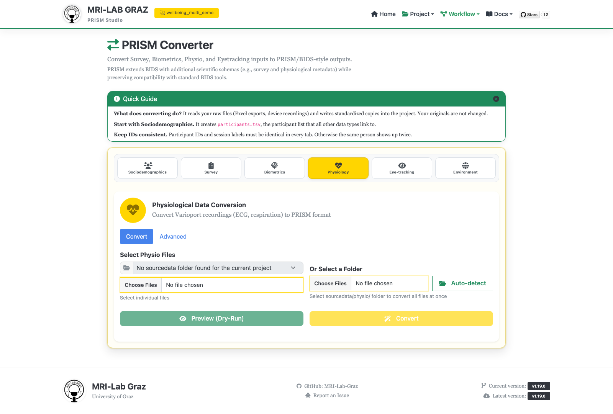

# Converter — Physio

Batch-converts physiological recordings (Varioport `.raw`/`.vpd` devices) into
BIDS-style physio outputs. Under the hood this drives the same batch-conversion path
as the CLI's `prism_tools.py physio batch-convert` — not `convert physio` (a separate,
older single-file/sourcedata-folder path that this tab does not use).



## Required naming

```text
sub-<label>[_ses-<label>][_task-<label>].[raw|vpd]
```

`task-` is optional. Files without a task go to `physio/` (EDF + PRISM sidecar).
Files with a task are written as BIDS `_physio.tsv.gz` + sidecar to a destination
you must choose: `beh`, `func` or `eeg` (the **Destination for files with a task**
select; command line: `--destination beh|func|eeg` on `physio batch-convert` and
`convert physio`). `physio/` never holds task-bound files.

Sleep tracking: raw night signals (actigraphy etc.) belong in `physio/`
(`recording-actigraphy`); nightly summaries belong in `biometrics/`.

## Step 1 — Select files or a folder

- **Select Physio Files** — pick individual `.raw`/`.vpd` files.
- **Or Select a Folder** — pick a whole folder, or click **Auto-detect** to look for
  `sourcedata/physio/` in your current project automatically.

## Step 2 — Advanced settings (optional)

A separate **Advanced** sub-tab exposes:

- **Device Type** — currently locked to Varioport (`.raw`/`.vpd`).
- **Base Sampling Rate Override** — defaults to 512 Hz.
- **Expected Channels** — informational readout (EKG, EDA, Marker), not configurable.
- **Generate per subject/session HTML report in `derivatives/physio`** — checked by
  default.

## Step 3 — Preview and convert

**Preview (Dry-Run)** and **Convert** buttons, both disabled until files/folder are
selected. A progress bar, **Cancel Running Conversion**, and a live Conversion Log
appear once running.

## What's next

- [Converter — Eyetracking](converter_eyetracking.md)
- [Validator](validator.md)
