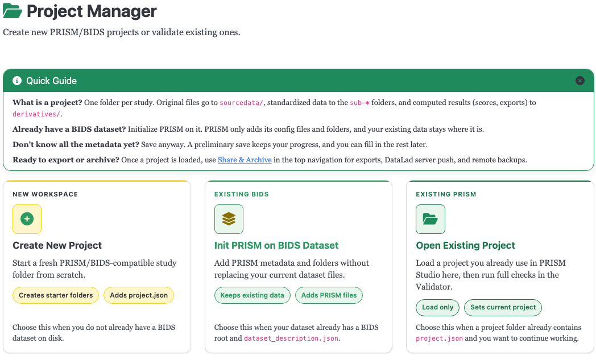

# Projects

The Projects page is the entry point for creating, opening, and re-opening PRISM
Studio projects.



## Goal

Get a project created or loaded so the rest of Studio (Converter, Validator,
Template Editor, Recipe Builder, Share/Export) has something to work against.

## Entry points

The page shows three cards:

- **Create New Project** — start a brand-new project from scratch.
- **Init PRISM on BIDS Dataset** — add PRISM's project files to a BIDS dataset that
  already exists, without overwriting anything already there.
- **Open Existing Project** — load a project you (or a collaborator) already created.

## Creating a new project

Fields on the **Create New Project** form:

- **Project Name** — required, letters/numbers/`_`/`-` only, no spaces. The field
  validates live as you type and explains specifically what's wrong (e.g. flags
  spaces or German umlauts/`ß` by name) rather than just turning red.
- **Project Location** — the parent folder the new project directory is created in.
- **Use DataLad version control for this new project** — optional checkbox. If
  DataLad/git-annex aren't installed, project creation silently falls back to a
  non-DataLad project rather than failing.

There is no modality or session picker at creation time — modalities and sessions are
no longer chosen up front; they're populated as you actually import data.

### Importing from a study application

If **MRI-Lab Graz study application import** is enabled in Global Settings, the
Study Metadata card (shown for both **Create New Project** and **Init PRISM on
BIDS Dataset**) gets an **Import from study application (survey.json)** file
button that prefills PI/author/ethics/funding/study fields from a Pavlovia
study-application export. This format is specific to MRI-Lab Graz's intake
survey, so the toggle is off by default; external users can leave it off and
fill in Study Metadata by hand.

Buttons: **Preliminary Save** (saves the form without creating the project yet) and
**Create Project**.

### Checked eligibility criteria

In **Study Metadata > Eligibility**, *Checked Criteria* holds limits the validator
tests against `participants.tsv`. Pick a standard term (Age, Sex, Handedness,
Group, Diagnosis, Education level) or **Other measure** (IQ, VO2max, ...), choose
**include** or **exclude**, then give a range (numeric, inclusive, either end may
stay empty) or the category labels. Enter the limits here only once: in the
[Sociodemographics converter](converter_participants.md) you just link a column
to the criterion. Participants outside a limit get a warning (`PRISM602`), never
an error, so you can validate while data collection is still running.

Rows follow the rule described under [Adding rows](#adding-rows-the-green-check-and-the-red-cross).
Accepted criteria count towards the Core fields: an *include* criterion satisfies
**Inclusion Criteria**, an *exclude* criterion **Exclusion Criteria**.

### Adding rows: the green check and the red cross

Everywhere on the Study Metadata form that you add a row (authors, funding, the
criteria and list fields, known issues, missing files, DOIs, checked criteria) the
same rule applies, so you always know whether a click is needed:

- A **new row is a draft** with a check mark and a gray **Cancel**. The check is gray
  and disabled while the row is empty or incomplete (for example without both author
  names), and a short hint says what is missing. It turns green as soon as the row
  can be accepted.
- **Click the green check to accept the row.** Only now does it count: it is saved,
  it feeds the badges and the readiness score, and it shows the **red cross**, which
  deletes it. A red cross always means "delete something that is already part of the form".
- A row with a check mark needs a click; a row without one never does.
- Rows that are already in the project when you open it are accepted.
- The recruitment-location search works the same way: its green **Add Selected Location**
  button accepts the place you searched for.
- **You cannot save while a draft with content is pending.** Create Project, Preliminary
  Save and Save are blocked, the pending rows get a yellow outline, and a message says to
  click the green check or Cancel. A completely empty draft is simply dropped.

### What gets created

```text
my_first_study/
├── dataset_description.json
├── .bidsignore
├── .prismrc.json
├── README.md
├── project.json
├── CITATION.cff
├── CHANGES
├── .gitattributes        (only if the DataLad text-tracking policy write succeeds)
├── sourcedata/
├── derivatives/
└── code/
    ├── library/
    └── recipes/
```

`participants.tsv` and `participants.json` are **not** created here — they're written
later, once you run the participants/sociodemographics import step (see
[Converter — Participants](converter_participants.md)).

The generated `README.md` describes this same layout and points you at `sourcedata/`,
`code/library/`, and `code/recipes/` for the next steps.

## Init PRISM on BIDS Dataset

Same file set as project creation, but only for files that don't already exist —
nothing your existing BIDS dataset already has gets overwritten. If the dataset has a
legacy `phenotype/` directory, it's auto-imported as part of this step.

## Deleting a project

A **Delete Project** button appears once a project is created or loaded (in the
project-created panel and in the loaded-project panel). Deletion is permanent and
irreversible — it removes the entire project folder from disk, including DataLad/git
history and derivatives.

To prevent accidental deletion, the confirmation dialog requires you to type the
project's exact name before the delete button enables. On confirmation, Studio clears
the project from your current-project and recent-projects state and returns you to the
Projects page.

There is still no "trash"/undo — deletion goes straight to the filesystem. If you want
a safety net, make sure the project is backed up (e.g. pushed to a DataLad sibling)
before deleting it here.

## Opening an existing project

The **Open Existing Project** form takes a single path, and accepts either:

- the project's root folder, or
- the path to its `project.json` file directly.

Submitting validates the project's structure, sets it as your active project for the
rest of Studio, and remembers it as your last-opened project.

A **Recent Projects** list (with a **Clear** button) tracks projects you've opened
before, de-duplicated by their resolved absolute path.

Each project gets a small emoji icon (e.g. 🧬) assigned the first time it's created
or loaded. It's chosen at random from a fixed set and then persisted into that
project's `project.json`, so it stays the same on every later load; it's shown next
to the project's name in Recent Projects and in the header once loaded, purely as a
visual identifier with no other meaning.

## What's next

- [Studio Guide overview](index.md)
- [Survey Import](converter_survey.md) or [Participants Import](converter_participants.md) to bring in your first data
- [Share / Export](export.md) once you have something to export
