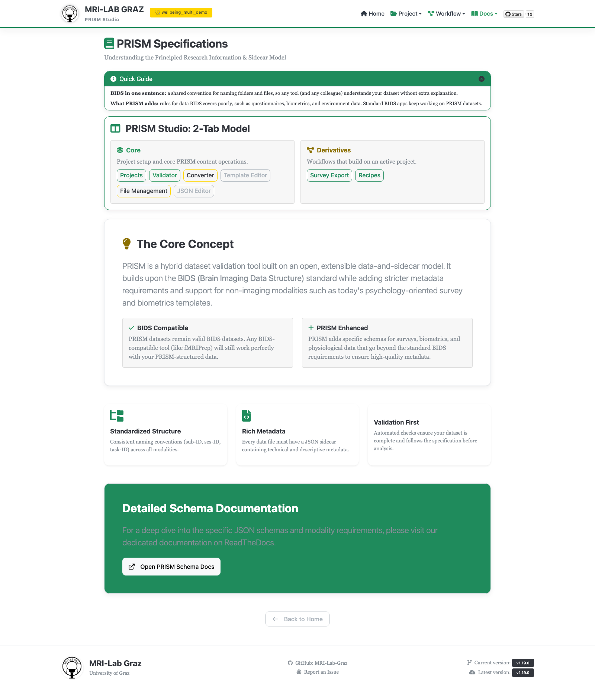

# Specifications

PRISM Studio organizes a project around two tiers: **Core** — the validated PRISM/
BIDS dataset itself (Projects, Validator, Converter, Template Editor, File
Management, JSON Editor) — and **Derivatives** — outputs computed from that dataset
(Survey Export, Recipes), which only become available once a project with data is
loaded. The Specifications screen is where Studio explains that split and points you
at both the tools and the underlying schema.

## Core vs. Derivatives

Every workflow in Studio belongs to one tier or the other. Core tools work with your
project's actual BIDS-compatible data and are always reachable. Derivatives tools —
Survey Export and Recipes — compute new outputs *from* that data, so they need a
project with real content loaded first; until then they show disabled with a
tooltip explaining why.

Underneath that split is PRISM's core relationship to BIDS: your dataset stays
BIDS-compatible at its core, with PRISM's schema-driven additions layered on top for
survey, biometrics, and other open-ended modalities — standardized
structure, rich metadata, and validation are the three principles that hold the
whole model together.

## Finding the schema itself

This screen doesn't define the schema — it links out to it. The bottom card has one
button per specification page (Survey, Biometrics, Biosample, Physio,
Environment, Events, `project.json`, `dataset_description.json`, filename rules), plus
the list of [validation errors and warnings](../ERROR_CODES.md) and the
[specification overview](../SPECIFICATIONS.md). Each spec page ends with a field
reference generated from the shipped schema, so it matches what the validator enforces.

## Propose changes

*Specifications → Propose changes* is where you tell the PRISM community what is missing. Find it as the
**Propose changes** entry in the navbar, in the sidebar of this screen, or through the call-to-action on the overview page. It
works with **no project open** and asks one thing at a time:

1. **What kind of data?** Every kind of data of the current specification, then *Nothing fits: a new kind of
   data*. Tick **Not sure** when you only picked the closest one; the maintainer then decides where it belongs.
   Kinds marked *(BIDS, passed through)* are handed to BIDS unchanged, so there is nothing to add for them.
2. **An accepted example beside your proposal.** On the left, an official library template of that kind of
   data with every entry filled (a pull-down switches between templates when there are several). On the right,
   the same entries for your data: a pull-down for every list of allowed values, ending with *Missing: add a
   value…* (a text box for your new value, lowercase letters, digits and `-`) and *Unknown*; a text box with an
   *Unknown* tick for free-text entries. Only the *Missing* entries are proposed; your filled and *Unknown*
   entries and the *Not sure* tick go along as context for the maintainer. When several lists have a missing
   value, each gets its own *Share the new …* button and the other new values appear in its context.
3. **Measurements**, for kinds of data with a measurement list (today biosample): a pull-down of the
   measurements PRISM knows, with ID and unit. When a specimen type is chosen in step 2, only that sample type's
   measurements are listed. The last entry, *Missing: add a measurement…*, opens the measurement form with the sample
   type from step 2 already filled in. Give its name, what it measures and its unit; *Share…* shows the proposal and
   sends your step-2 entries and the *Not sure* tick along as context.
4. **Nothing fits: a new kind of data** opens a short form: a description (what is measured, how, with which device
   or lab, what one file holds), a sample file (pasted or picked as a text file; made-up data only, never real
   participant data) and, optionally, the closest kind of data (prefilled with your step-1 choice). PRISM cannot
   validate such files until the maintainer has added the new kind of data and it is in a PRISM release, so plan for
   this before your study starts. *Share…* opens a prefilled form with the description and closest kind; the sample
   is not in the link: paste it into the form's *Sample file* field. *Download* saves everything as one text file.

**Nothing is sent from Studio.** *Share…* shows the proposal and opens a prefilled form on GitHub in a new tab
(or lets you download `proposal.json`); you submit the form yourself, and the maintainers may choose a different
ID or name. When the proposal is too long for a link, the dialog shows the proposal and the context to paste
into the form.

**With a project open**, the page also offers *Use in my open project*, so your own project can use the new item
right away, before the community has decided. For lists it adds every *Missing* value of step 2 to the project, for
any kind of data (stored in `code/specification/patches/<kind>.json`, the same action as
`prism_tools.py spec local add-values --modality <kind>`).

- **Found in your data** (measurement): columns of your biosample files that neither the official registry nor
  your project knows. Click one to fill the form, then *Use in my open project* makes the metric a local term.
  It is stored in the project at `code/specification/terms/`, and the same action is
  `prism_tools.py spec local add-term`. A measurement typed by hand can be shared, but using it in a project
  needs a column found in your data.
- **Found in your data** (list): values in your biosample files outside the allowed ones. *Add to this
  project* allows the value for this project (stored in `code/specification/patches/biosample.json`, the same
  action as `prism_tools.py spec local add-values`), so the next validation accepts it.
- **Local metrics** and **additions in this project** list what the project carries, each with its status and,
  for additions, its kind of data. *Share…* proposes one, *Share all local measurements…* puts every local measurement
  in one proposal (up to 40 term files), *Share additions (kind)…* does the same for the list values of one kind of data, and *Remove*
  deletes the local copy. An item the official registry has since adopted is marked *now-official* and can be
  removed. A schema addition is reviewed by a maintainer and gets a new minor version.

The same steps without a browser: `prism_tools.py spec catalog`, `spec propose-values` and `spec propose-metric`
(see the [CLI reference](../CLI_REFERENCE.md)); `spec propose-metric --project <folder>` also accepts the sample types your project added.

## What's next

- [Projects](projects.md) · [Validator](validator.md) · [Template Editor](template_editor.md)
- [Recipe Builder](recipe_builder.md) · [Survey Export](survey_generator.md)
